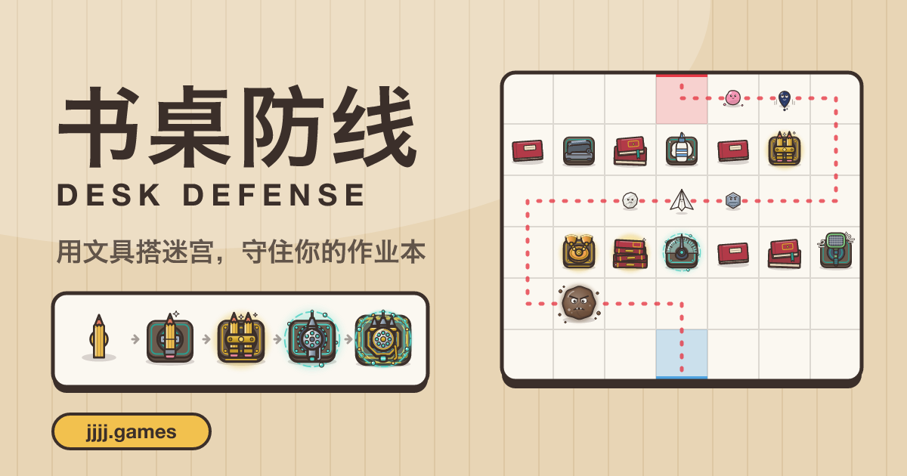
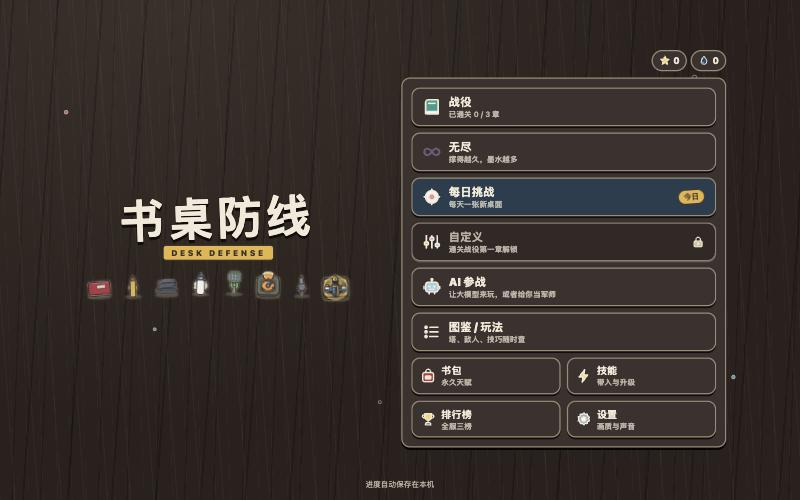

<div align="center">

# Desk Defense · 书桌防线

**A maze tower defense game played on a desk with stationery, which large language models can play too.**

[简体中文](README.md) · **English** · [繁體中文](README.zh-TW.md) · [日本語](README.ja.md)

[](https://jjjj.games)
[](LICENSE)
[](https://linux.do/)

[Play online](https://jjjj.games) · [About](https://jjjj.games/about?lang=en) · [AI play docs (Chinese)](docs/10-Agent参战.md) · [Contributing (Chinese)](CONTRIBUTING.md)

Released and discussed on the [LINUX DO](https://linux.do/) community



</div>

## What is it

Desk Defense is a maze tower defense game. The board is a 12×14 desk, and the towers are stationery: pencils, staplers, desk lamps, compasses. Every tower (walls included) blocks the path, so where you place towers is how you build the maze.

It runs in the browser on phones, tablets and computers. You can also install it as a PWA or package it as an iOS / Android / desktop app. No sign-up; progress is saved on your device.

Besides playing it yourself, you can plug in a large language model: let the AI play for you, advise you, set the waves against you, or let two models fight each other.



## What's in the game

- **3 modes**: Campaign (3 chapters), Endless (Easy, Normal, Hard, Nightmare, Abyss I–X), Custom; plus a Daily Challenge.
- **12 towers, 16 enemies and bosses, 9 elite affixes**: towers level from Lv1 to Lv10, pick legend branch A or B at Lv10, then evolve up to ★3 to unlock an active ability.
- **10 active skills, 20 in-run perks, permanent talents**, and combos between adjacent towers.
- **Dynamic battlefield**: multiple spawn points, air drops, random events and random clutter layouts, so no two runs share the same map.
- **Global leaderboards**: Endless, Daily and Campaign, plus an AI board and an AI vs AI board. The core logic is fully deterministic and every score carries its full command log, so runs can be replayed and verified.
- **Four languages**: Simplified Chinese, Traditional Chinese, English, Japanese; light and dark themes.
- **Online updates and changelog**: when a new version ships, an open game shows a notice listing what changed, and one click updates it. The bottom of the Settings page shows the changelog for every version ([CHANGELOG.md](CHANGELOG.md), Chinese). Every panel can be collapsed, so nothing covers the board on phones either.
- **Original art and music**: towers and enemies are flat geometric SVGs; the background music is synthesized live with WebAudio (4 styles).

## Let an LLM play

The main menu's AI section has four ways to play:

| Mode | What it does |
|---|---|
| AI player | The model plays the whole run from wave 1; you watch its reasoning and every action |
| AI advisor | You play; the model suggests moves you can apply with one tap |
| AI sets the waves | The model is the attacker and rewrites each upcoming wave; you defend |
| AI vs AI | Two models in one run: one attacks by rewriting waves, one defends by building |

- **Models**: hosted APIs such as Claude, OpenAI, Gemini and DeepSeek, any OpenAI-compatible endpoint, local Ollama / LM Studio, or an offline demo that needs no key.
- **Core strategy**: before the run, pick Pencil rush, Area damage, Beams, Economy or Anti-air, or let the AI pick. You can change it mid-run with one sentence.
- **Talk to it anytime**: tell the AI "more anti-air", "save money" or "make the maze longer" during the run.
- **Visible reasoning**: the side panel shows what the model sees each turn, its thinking, the tools it calls and what each action did.
- **Fair play**: every AI action goes through the same validation as a player's click, so it can't cheat. AI scores are ranked separately and never mix with human ones.
- **Cost control**: incremental context, prefix caching and budget tiers; reasoning levels and cost estimates per model (pricing data from [modelinfo.dev](https://modelinfo.dev)).
- **Your key stays yours**: the API key lives in memory by default (optionally in sessionStorage, cleared when the tab closes). Requests go straight from your browser to the model provider and **never through this site's server**.
- **Background mode**: turn it on in Settings and, while an AI is playing (AI player, Let AI play for me, AI vs AI), the run keeps going when you switch tabs or minimize the window, with the current wave and lives in the tab title. Mobile browsers pause pages in the background, so this only works on desktop.

You can also play from the command line or over MCP:

```bash
npm run agent:play -- --provider scripted --max-waves 10
```

```bash
npm run mcp
```

`agent:play` runs a full headless game in the terminal and writes a report (the command above uses the built-in strategy and needs no key; all options are listed at the top of `scripts/agent-play.ts`). `mcp` starts an MCP server, so clients such as Claude Code and Claude Desktop can play as the player.

## Quick start

Requires Node.js 22.22 or later.

```bash
git clone https://github.com/Owlbay/desk-defense.git
```

```bash
cd desk-defense && npm install
```

```bash
npm run dev
```

Open the address shown in the terminal. To play on your phone, open the Network address from a phone on the same local network.

| Command | What it does |
|---|---|
| `npm run dev` | Dev server with hot reload |
| `npm run build` | Type-check and build into `dist/` (includes the PWA; deployable to any static host) |
| `npm run preview` | Preview the production build locally |
| `npm run check` | Pre-commit checks: type-check, ESLint, Prettier, unit tests (same as CI) |
| `npm run dev:api` | Build, then run the full site with the leaderboard API locally via wrangler |
| `npm run sim -- --scenario calib` | Balance simulation: bots play every difficulty; report at `scripts/out/report.html` |
| `npm run agent:eval` | AI evaluation: compare models / settings / core strategies on the same seeds |
| `npm run cap:ios` / `npm run cap:android` | Build and sync to the Capacitor native projects |
| `npm run tauri:dev` / `npm run tauri:build` | Tauri desktop dev / package |
| `npm run release -- patch --deploy` | Release: bump the version, write the changelog, commit, tag, push and deploy; GitHub creates the Release when the tag lands (see [CONTRIBUTING](CONTRIBUTING.md#发版与更新日志), Chinese) |

## Self-hosting

The static part (`dist/`) works on any static host. The global leaderboard needs Cloudflare Pages Functions + D1:

1. Create the database with `npx wrangler@4 d1 create desk-defense` and put the printed `database_id` into `wrangler.toml`.
2. Create the tables: `npm run db:migrate:remote`.
3. Set the secret: `npx wrangler@4 pages secret put HASH_SALT --project-name desk-defense` (a long random string used to hash IPs and device IDs).
4. Deploy: `npm run deploy`.

Without a database the game shows "online features unavailable" and everything else works. Details in [doc 12 (Chinese)](docs/12-全服排行榜.md).

The native apps (iOS / Android / desktop) wrap the same `dist/`; see [doc 07 §2.3 (Chinese)](docs/07-技术与多平台.md). The repository contains no signing configuration or store accounts.

## Project layout

| Directory | Contents |
|---|---|
| `src/core/` | Pure game logic (no browser APIs, fully deterministic): world state, pathfinding, combat, waves, skills, perks |
| `src/config/` | All tuning data: towers, enemies, affixes, skills, perks, talents, difficulty, maps, campaign |
| `src/render/` | Phaser board rendering, effects, touch and mouse input on the board |
| `src/ui/` | HTML interface: menus, in-run HUD, codex, AI side panel, music |
| `src/agent/` | AI play: observations, intent planner, tools, core strategy, provider adapters |
| `src/meta/` | Saves, progression, unlocks, leaderboards, replays |
| `src/shared/` | Validation and encoding shared by client and server |
| `functions/` | Cloudflare Pages Functions (the `/api/*` leaderboard API) |
| `migrations/` | D1 database migrations |
| `scripts/` | Balance simulation, bots, AI evaluation, MCP server, doc and art generation |
| `tests/` | Unit tests (500+, no network needed) |
| `art/` | SVG art sources (`art/gallery.html` previews every asset) |

Tech stack: TypeScript, Phaser 3, Vite, Vitest; Cloudflare Pages + D1; Capacitor, Tauri.

## Design docs

The design docs and the player guide are written in Chinese. The [docs/](docs/) folder covers gameplay, towers, enemies, modes and difficulty, skills, art, architecture, the dynamic battlefield, AI play, legend evolution and the leaderboard. The in-game codex is available in all four languages.

## Feedback

- **Bugs and ideas**: [open an issue](https://github.com/Owlbay/desk-defense/issues). Please include the seed (copy it from the pause menu), the difficulty and your browser. Scores carry replays, so issues are quick to reproduce.
- **Discussion and high scores**: post on [LINUX DO](https://linux.do/). Tell us how many waves your model survived and which core strategy works best.
- **Errors while an AI plays**: a screenshot or the error copied from the side panel is enough. **Remove your API key from screenshots and logs first.**

## Contributing

Pull requests are welcome. Please read [CONTRIBUTING.md](CONTRIBUTING.md) (Chinese) first: it covers directory conventions, determinism rules, i18n, testing and deployment. Run `npm run check` before committing.

## Open source

- **Fully open source**: the client, the server API (`functions/`), database migrations, SVG art sources, music generation code and AI evaluation scripts are all in this repository. Nothing is closed.
- **Free, no login**: no paid content, no ads, no affiliate links, no chat groups.
- **Privacy**: progress stays on your device. Uploaded scores carry only a nickname and a hashed device ID. AI scores show only the model name and reasoning level, never which provider or relay you used.
- **License**: [MIT](LICENSE).

## Community and links

This project takes part in and supports the [LINUX DO](https://linux.do/) community. Thanks to everyone there for the feedback and support.

- [LINUX DO - 新的理想型社区](https://linux.do/)
