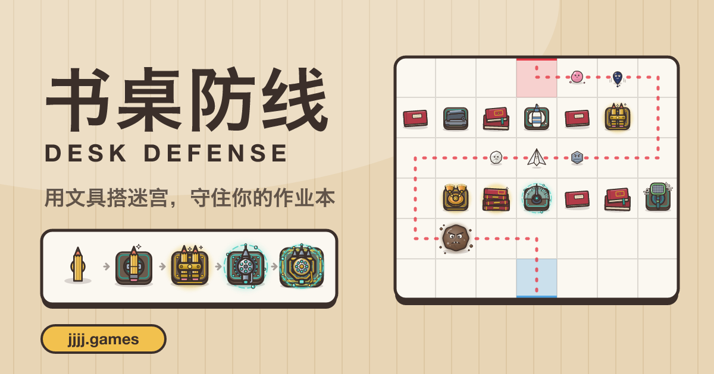
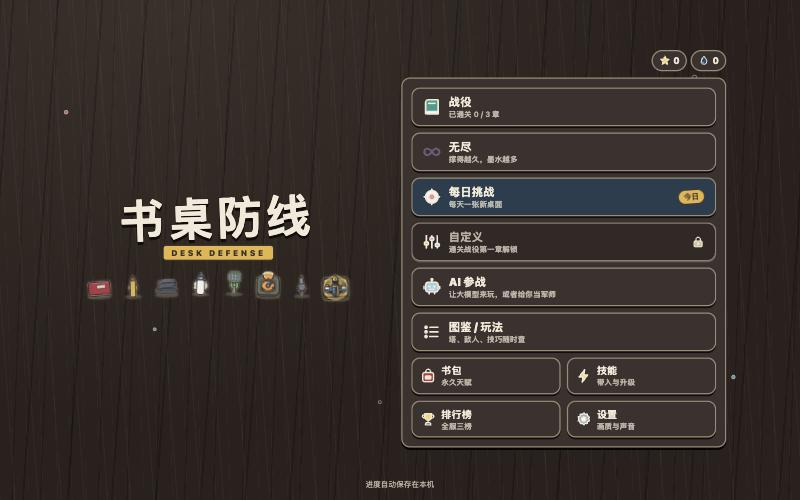

<div align="center">

# 書桌防線 · Desk Defense

**机の上で文房具を並べて迷路を作るタワーディフェンス。大規模言語モデルにも遊ばせられます。**

[简体中文](README.md) · [English](README.en.md) · [繁體中文](README.zh-TW.md) · **日本語**

[](https://jjjj.games)
[](LICENSE)
[](https://linux.do/)

[オンラインで遊ぶ](https://jjjj.games) · [紹介ページ](https://jjjj.games/about?lang=ja) · [AI 参戦ドキュメント（中国語）](docs/10-Agent参战.md) · [開発に参加（中国語）](CONTRIBUTING.md)

本プロジェクトは [LINUX DO](https://linux.do/) コミュニティで公開・交流しています



</div>

## どんなゲーム？

書桌防線（Desk Defense）は迷路型のタワーディフェンスです。盤面は 12×14 の机で、鉛筆、ホッチキス、デスクライト、コンパスといった文房具がタワーになります。すべてのタワー（壁も含む）が道をふさぐので、タワーの置き方がそのまま迷路の形になります。

ブラウザを開くだけで遊べて、スマホ・タブレット・PC に対応。PWA としてインストールしたり、iOS / Android / デスクトップアプリとしてパッケージしたりもできます。登録不要で、進行状況は端末に保存されます。

自分で遊ぶだけでなく、大規模言語モデルをつなぐこともできます。AI に代わりにプレイさせたり、アドバイスさせたり、ウェーブを出題させたり、2 つのモデルを対戦させたりできます。



## ゲーム内容

- **3 つのモード**：キャンペーン（3 章）、エンドレス（かんたん・ノーマル・ハード・悪夢・魔境 I～X）、カスタム。さらにデイリーチャレンジ。
- **タワー 12 種、敵とボス 16 種、エリートアフィックス 9 種**：タワーは Lv1 から Lv10 まで成長し、Lv10 で伝説ルート A / B を選び、さらに ★3 まで進化するとアクティブ能力が解放されます。
- **アクティブスキル 10 種、プレイ中のパーク 20 種、永続タレント**、隣り合うタワーのコンボ。
- **動く戦場**：複数の出現口、空挺降下、ランダムイベント、ランダムな障害物配置で、毎回マップが変わります。
- **全体ランキング**：エンドレス・デイリー・キャンペーンの 3 つに加えて、AI ランキングと AI 対戦ランキング。コアロジックは完全に決定的で、スコアには全操作ログが付くため、リプレイで再現できます。
- **4 言語**：简体中文・繁體中文・English・日本語。ライト / ダークテーマ。
- **オリジナルのアートと音楽**：タワーと敵は SVG のフラットな幾何学スタイル。BGM は WebAudio でリアルタイム合成（4 スタイル）。

## AI 参戦：LLM に遊ばせる

メインメニューの「AI 参戦」には 4 つの遊び方があります。

| 遊び方 | 内容 |
|---|---|
| AI プレイヤー | モデルが第 1 ウェーブから最後まで操作し、あなたはその思考と操作を観戦 |
| AI 軍師 | あなたがプレイし、モデルがアドバイス。ワンタップで採用できます |
| AI 出題 | モデルが攻撃側となり、各ウェーブの開始前に敵の構成を書き換えます。あなたは防衛 |
| AI 対戦 | 2 つのモデルが同じ局で対戦。片方が出題して攻め、片方がタワーを建てて守ります |

- **モデル**：Claude、OpenAI、Gemini、DeepSeek などのホスト型 API、OpenAI 互換の中継サービス、ローカルの Ollama / LM Studio、または Key 不要のオフラインデモ。
- **中心戦略**：開始時に「鉛筆主体」「範囲攻撃」「ビーム」「経済」「対空重視」を指定するか、AI に任せられます。対局中もひとことで変更できます。
- **いつでも指示**：対局中に「対空を増やして」「先に貯金」「迷路を長くして」と AI に直接話しかけられます。
- **思考が見える**：サイドパネルに、モデルへ送った局面、モデルの思考、呼び出したツール、各操作の結果がリアルタイムで表示されます。
- **公平**：AI の操作はすべてプレイヤーのクリックと同じ検証を通るため、ズルはできません。AI のスコアは別ランキングで、人間のランキングには混ざりません。
- **コスト節約**：コンテキストの差分送信、プレフィックスキャッシュ、予算段階。モデルごとに思考レベルと費用の目安を表示（価格データは [modelinfo.dev](https://modelinfo.dev)）。
- **Key の安全**：API Key は既定でメモリにのみ保持（任意で sessionStorage に保存、タブを閉じると消去）。ブラウザからモデルのサービスへ直接接続し、**本サイトのサーバーには送られません**。

Web 版のほか、コマンドラインや MCP からも遊べます。

```bash
npm run agent:play -- --provider scripted --max-waves 10
```

```bash
npm run mcp
```

`agent:play` はターミナルでヘッドレスに 1 局を最後まで実行し、レポートを出力します（上のコマンドは内蔵戦略を使うので Key 不要。全オプションは `scripts/agent-play.ts` の冒頭にあります）。`mcp` は MCP サーバーを起動し、Claude Code や Claude Desktop などのクライアントがプレイヤーとして遊べます。

## はじめかた

Node.js 22.22 以上が必要です。

```bash
git clone https://github.com/Owlbay/desk-defense.git
```

```bash
cd desk-defense && npm install
```

```bash
npm run dev
```

ターミナルに表示されたアドレスを開けば遊べます。スマホと PC が同じ LAN にある場合は、スマホでターミナルの Network アドレスを開くとスマホで遊べます。

| コマンド | 内容 |
|---|---|
| `npm run dev` | 開発サーバー（ホットリロード） |
| `npm run build` | 型チェックして `dist/` にビルド（PWA を含み、任意の静的ホスティングに配置可能） |
| `npm run preview` | ビルド結果をローカルでプレビュー |
| `npm run check` | コミット前チェック：型チェック、ESLint、Prettier、ユニットテスト（CI と同じ） |
| `npm run dev:api` | ビルド後、wrangler でランキング API 付きのサイト全体をローカル起動 |
| `npm run sim -- --scenario calib` | バランスシミュレーション：ボットで各難易度をプレイ。レポートは `scripts/out/report.html` |
| `npm run agent:eval` | AI 評価：同じシードでモデル / 設定 / 中心戦略を比較 |
| `npm run cap:ios` / `npm run cap:android` | ビルドして Capacitor のネイティブプロジェクトに同期 |
| `npm run tauri:dev` / `npm run tauri:build` | Tauri デスクトップ版の開発 / パッケージ |

## セルフホスト

静的な部分（`dist/`）はどの静的ホスティングにも置けます。全体ランキングには Cloudflare Pages Functions + D1 が必要です。

1. データベースを作成：`npx wrangler@4 d1 create desk-defense` を実行し、表示された `database_id` を `wrangler.toml` に記入。
2. テーブルを作成：`npm run db:migrate:remote`。
3. シークレットを設定：`npx wrangler@4 pages secret put HASH_SALT --project-name desk-defense`（IP とデバイス ID のハッシュに使うランダムな長い文字列）。
4. デプロイ：`npm run deploy`。

データベースがない場合は「オンライン機能は利用できません」と表示され、それ以外は普通に動きます。詳細は [ドキュメント 12（中国語）](docs/12-全服排行榜.md)。

ネイティブアプリ（iOS / Android / デスクトップ）は同じ `dist/` をラップしたものです。手順は [ドキュメント 07 §2.3（中国語）](docs/07-技术与多平台.md)。リポジトリに署名設定やストアのアカウントは含まれていません。

## ディレクトリ構成

| ディレクトリ | 内容 |
|---|---|
| `src/core/` | 純粋なゲームロジック（ブラウザ非依存、完全に決定的）：ワールド状態、経路探索、戦闘、ウェーブ、スキル、パーク |
| `src/config/` | すべての数値設定：タワー、敵、アフィックス、スキル、パーク、タレント、難易度、マップ、キャンペーン |
| `src/render/` | Phaser による盤面描画、エフェクト、盤面上のタッチとマウス入力 |
| `src/ui/` | HTML UI：メニュー、ラン中の HUD、図鑑、AI サイドパネル、音楽 |
| `src/agent/` | AI 参戦：観測、意図プランナー、ツール、中心戦略、各社モデルのアダプター |
| `src/meta/` | セーブ、進行、アンロック、ランキング、リプレイ |
| `src/shared/` | クライアントとサーバーで共有する検証とエンコード |
| `functions/` | Cloudflare Pages Functions（`/api/*` ランキング API） |
| `migrations/` | D1 データベースのマイグレーション |
| `scripts/` | バランスシミュレーション、ボット、AI 評価、MCP サーバー、ドキュメントとアートの生成 |
| `tests/` | ユニットテスト（500 以上、ネットワーク不要） |
| `art/` | SVG アートのソース（`art/gallery.html` で全素材をプレビュー） |

技術スタック：TypeScript、Phaser 3、Vite、Vitest、Cloudflare Pages + D1、Capacitor、Tauri。

## 設計ドキュメント

設計ドキュメントとプレイヤーガイドは現在簡体字中国語のみです。[docs/](docs/) にあり、遊び方、タワー、敵、モードと難易度、スキル、アート、アーキテクチャ、動く戦場、AI 参戦、伝説進化、ランキングを扱っています。ゲーム内の図鑑は 4 言語に対応しています。

## フィードバックと交流

- **バグや提案**：[Issue を作成](https://github.com/Owlbay/desk-defense/issues)。シード（一時停止メニューからコピーできます）、難易度、ブラウザを添えてもらえると助かります。スコアにはリプレイが付くので、すぐに再現できます。
- **議論やスコア自慢**：[LINUX DO](https://linux.do/) に投稿してください。あなたのモデルが何ウェーブまで耐えたか、どの中心戦略が強いかなど。
- **AI プレイ中のエラー**：スクリーンショットか、サイドパネルのエラーをコピーしてもらえれば十分です。**スクリーンショットやログから API Key を必ず消してください。**

## 開発に参加

Pull Request を歓迎します。まず [CONTRIBUTING.md](CONTRIBUTING.md)（中国語）を読んでください。ディレクトリの約束、決定性の要件、国際化、テストとデプロイの流れが書いてあります。コミット前に `npm run check` を実行してください。

## オープンソースについて

- **完全オープンソース**：ゲームクライアント、サーバー API（`functions/`）、データベースのマイグレーション、SVG アートのソース、音楽生成コード、AI 評価スクリプトがすべてこのリポジトリにあり、非公開の部分はありません。
- **無料、ログイン不要**：有料コンテンツ、広告、アフィリエイトリンク、グループ勧誘はありません。
- **プライバシー**：進行状況は端末にのみ保存されます。スコアのアップロードにはニックネームとハッシュ化したデバイス ID だけが含まれます。AI のスコアにはモデル名と思考レベルだけが表示され、どのサービスや中継を使ったかは表示されません。
- **ライセンス**：[MIT](LICENSE)。

## コミュニティとリンク

本プロジェクトは [LINUX DO](https://linux.do/) コミュニティに参加し、支持しています。フィードバックと応援に感謝します。

- [LINUX DO - 新的理想型社区](https://linux.do/)
