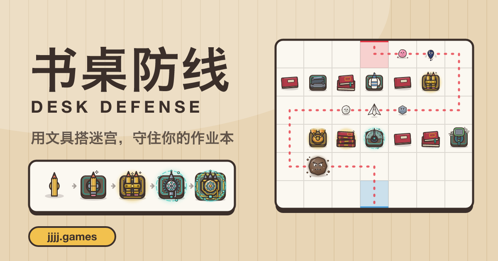
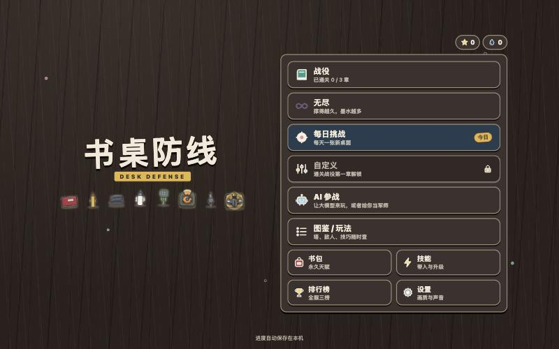

<div align="center">

# 書桌防線 · Desk Defense

**在書桌上用文具擺迷宮的塔防遊戲，也可以讓大型語言模型來玩。**

[简体中文](README.md) · [English](README.en.md) · **繁體中文** · [日本語](README.ja.md)

[](https://jjjj.games)
[](LICENSE)
[](https://linux.do/)

[線上試玩](https://jjjj.games) · [介紹頁](https://jjjj.games/about?lang=zh-TW) · [AI 參戰文件（簡體）](docs/10-Agent参战.md) · [參與開發（簡體）](CONTRIBUTING.md)

本專案在 [LINUX DO](https://linux.do/) 社群發布與交流



</div>

## 這是什麼

書桌防線是一款迷宮式塔防遊戲。棋盤是一張 12×14 的書桌，鉛筆、訂書機、檯燈、圓規這些文具就是塔；每座塔（包括牆）都會擋路，所以怎麼擺塔，就是怎麼蓋迷宮。

瀏覽器打開就能玩，手機、平板、電腦都支援，也可以安裝成 PWA，或打包成 iOS / Android / 桌面應用程式。不用註冊，進度保存在本機。

除了自己玩，還可以接上大型語言模型：讓 AI 替你打、給你出主意、給你出題，或者讓兩個模型對打。



## 遊戲內容

- **3 種模式**：戰役（3 章）、無盡（簡單、普通、困難、噩夢、魔境 I～X）、自訂；另有每日挑戰。
- **12 座塔、16 種敵人和 Boss、9 種菁英詞綴**：塔從 Lv1 升到 Lv10，Lv10 選傳奇分支 A / B，之後還能進化到 ★3 解鎖主動能力。
- **10 個主動技能、20 個局內增益、永久天賦**，相鄰的塔有組合技。
- **動態戰場**：多點出怪、空降出生點、隨機事件、隨機雜物配置，每局地形都不一樣。
- **全服排行榜**：無盡、每日、戰役三個榜，外加 AI 榜和 AI 對戰榜。核心邏輯完全確定性，成績附帶完整指令紀錄，可以回放重現。
- **四種語言**：簡體中文、繁體中文、English、日本語；淺色 / 深色主題。
- **原創美術與配樂**：塔和敵人都是 SVG 幾何扁平風，背景音樂由 WebAudio 即時合成（4 種曲風）。

## AI 參戰：讓大型語言模型來玩

主選單「AI 參戰」裡有四種玩法：

| 玩法 | 說明 |
|---|---|
| AI 玩家 | 模型從第 1 波開始全程操作，你在旁邊看它的思路和每一步操作 |
| AI 軍師 | 你自己玩，模型只給建議，可以一鍵執行 |
| AI 出題 | 模型扮演進攻方，每波開始前改寫下一波的敵人，你來防守 |
| AI 對戰 | 兩個模型同局對抗：一個出題進攻，一個蓋塔防守 |

- **模型來源**：Claude、OpenAI、Gemini、DeepSeek 等託管 API，OpenAI 相容的中轉服務，本機的 Ollama / LM Studio，或不需要 Key 的離線示範。
- **中心策略**：開局可以指定「鉛筆流」「範圍流」「光束流」「經濟複利」「重防空」，或讓 AI 自動選，也能在對局中用一句話修改。
- **隨時下指令**：對局中可以直接對 AI 說「多蓋防空」「先存錢」「把迷宮拉長」。
- **看得見的思路**：側欄即時顯示每次送給模型的局面、模型的思考、呼叫的工具和操作結果。
- **公平**：AI 的每個操作都和玩家點擊走同一套驗證，無法作弊；AI 成績單獨排名，不混進真人榜。
- **省錢**：上下文增量傳送、前綴快取、預算分級；依模型顯示思考檔位與費用估算（價格資料來自 [modelinfo.dev](https://modelinfo.dev)）。
- **Key 的安全**：API Key 預設只存在記憶體中，可選擇存到 sessionStorage（關閉分頁即清除）；只從你的瀏覽器直連模型服務，**不會傳到本站伺服器**。

除了網頁，也可以用命令列或 MCP 接入：

```bash
npm run agent:play -- --provider scripted --max-waves 10
```

```bash
npm run mcp
```

`agent:play` 在終端機裡無頭跑完一整局並輸出報告（上面這條用內建策略，不需要 Key；全部參數見 `scripts/agent-play.ts` 開頭）；`mcp` 啟動 MCP 服務，Claude Code、Claude Desktop 等用戶端可以直接當玩家。

## 快速開始

需要 Node.js 22.22 或更新版本。

```bash
git clone https://github.com/Owlbay/desk-defense.git
```

```bash
cd desk-defense && npm install
```

```bash
npm run dev
```

打開終端機顯示的網址就能玩。手機和電腦在同一個區域網路時，用手機打開終端機裡的 Network 網址，就能在手機上玩。

| 指令 | 作用 |
|---|---|
| `npm run dev` | 開發伺服器（熱更新） |
| `npm run build` | 型別檢查並打包到 `dist/`（含 PWA，可部署到任何靜態託管） |
| `npm run preview` | 本機預覽打包結果 |
| `npm run check` | 提交前檢查：型別檢查、ESLint、Prettier、單元測試（與 CI 相同） |
| `npm run dev:api` | 打包後用 wrangler 在本機啟動含排行榜介面的完整網站 |
| `npm run sim -- --scenario calib` | 平衡模擬：用機器人跑各難度，報告在 `scripts/out/report.html` |
| `npm run agent:eval` | AI 評測：同一批種子比較不同模型 / 設定 / 中心策略 |
| `npm run cap:ios` / `npm run cap:android` | 建置並同步到 Capacitor 原生專案 |
| `npm run tauri:dev` / `npm run tauri:build` | Tauri 桌面版開發 / 打包 |

## 自行部署

純靜態部分（`dist/`）可以放到任何靜態託管。全服排行榜需要 Cloudflare Pages Functions + D1：

1. 建立資料庫：`npx wrangler@4 d1 create desk-defense`，把輸出的 `database_id` 填進 `wrangler.toml`。
2. 建表：`npm run db:migrate:remote`。
3. 設定機密：`npx wrangler@4 pages secret put HASH_SALT --project-name desk-defense`（隨機長字串，用來雜湊 IP 和裝置 ID）。
4. 部署：`npm run deploy`。

沒有綁定資料庫時，遊戲顯示「線上功能不可用」，其他功能照常。詳見 [文件 12（簡體）](docs/12-全服排行榜.md)。

原生應用程式（iOS / Android / 桌面）用同一份 `dist/` 包殼，步驟見 [文件 07 §2.3（簡體）](docs/07-技术与多平台.md)。倉庫裡不含任何簽章設定和商店帳號。

## 程式結構

| 目錄 | 內容 |
|---|---|
| `src/core/` | 純遊戲邏輯（不依賴瀏覽器，完全確定性）：世界狀態、尋路、戰鬥、波次、技能、增益 |
| `src/config/` | 全部數值設定：塔、敵人、詞綴、技能、增益、天賦、難度、地圖、戰役 |
| `src/render/` | Phaser 棋盤繪製、特效、棋盤上的觸控和滑鼠輸入 |
| `src/ui/` | HTML 介面：選單、局內 HUD、圖鑑、AI 側欄、配樂 |
| `src/agent/` | AI 參戰：觀測、意圖規劃器、工具、中心策略、各家模型轉接 |
| `src/meta/` | 存檔、進度、解鎖、排行榜、回放 |
| `src/shared/` | 前端和伺服器共用的驗證與編碼 |
| `functions/` | Cloudflare Pages Functions（`/api/*` 排行榜介面） |
| `migrations/` | D1 資料庫遷移 |
| `scripts/` | 平衡模擬、機器人、AI 評測、MCP 服務、文件和美術產生 |
| `tests/` | 單元測試（500+ 個，不需要網路） |
| `art/` | SVG 美術原始檔（`art/gallery.html` 預覽全部素材） |

技術堆疊：TypeScript、Phaser 3、Vite、Vitest；Cloudflare Pages + D1；Capacitor、Tauri。

## 設計文件

設計文件和玩家指南目前只有簡體中文版，放在 [docs/](docs/)，涵蓋玩法、防禦塔、敵人、模式與難度、技能、美術、架構、動態戰場、AI 參戰、傳奇進化和排行榜。遊戲內的圖鑑有四種語言。

## 回饋與交流

- **Bug 和建議**：[提交 Issue](https://github.com/Owlbay/desk-defense/issues)。最好附上種子（暫停選單裡可以複製）、難度和瀏覽器；成績自帶回放，重現起來很快。
- **討論和曬成績**：歡迎到 [LINUX DO](https://linux.do/) 發文交流，聊聊你的模型打到了第幾波、哪種中心策略最好用。
- **用 AI 玩時出錯**：截圖或複製側欄裡的錯誤訊息就行，**先把 Key 從截圖和紀錄裡去掉**。

## 參與貢獻

歡迎提 Pull Request。開始之前請先讀 [CONTRIBUTING.md](CONTRIBUTING.md)（簡體），裡面有目錄約定、確定性要求、國際化、測試與部署流程。提交前跑一遍 `npm run check`。

## 開源說明

- **完整開源**：遊戲用戶端、伺服器介面（`functions/`）、資料庫遷移、美術 SVG 原始檔、配樂產生程式、AI 評測腳本全部在這個倉庫裡，沒有閉源部分。
- **免費，不需要登入**：沒有付費內容、沒有廣告、沒有推廣連結，也沒有任何群組。
- **隱私**：進度只存在本機。上傳成績時只帶暱稱和雜湊過的裝置識別碼；AI 成績只顯示模型名稱和思考檔位，不顯示你用的是哪家服務或中轉。
- **授權**：[MIT](LICENSE)。

## 社群與友情連結

本專案積極參與並認可 [LINUX DO](https://linux.do/) 社群，感謝佬友們的回饋和支持。

- [LINUX DO - 新的理想型社区](https://linux.do/)
