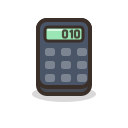

<!-- 本文件由 scripts/gen-data-docs.ts 自动生成，请勿手改；修改游戏配置后运行 npm run docs:data 重新生成 -->

# 组合与加成

相邻组合技、书本墙相邻加成与计算器光环。下方"实测"列是在临时对局里把两座 Lv1 塔上下左右相邻摆放后，`getTowerInfo()` 面板相对单独摆放时的变化。

> 返回 [数据索引](./README.md)

## 相邻组合技

两座塔上下左右相邻即激活（斜向不算），双方面板都会显示组合特性。

|  | 组合 | 塔 | 效果 | 实测激活 | 实测面板变化（Lv1） |
|---|---|---|---|---|---|
|  | 带橡皮的铅笔 | 铅笔塔 + 橡皮擦 | 铅笔每次命中 −0.5 护甲 | ✔ | 铅笔塔：面板无变化（效果在战斗中结算） 橡皮擦：面板无变化（效果在战斗中结算） |
|  | 粘住再钉 | 胶水瓶 + 订书机 | 订书机对被减速的敌人伤害 +25% | ✔ | 胶水瓶：面板无变化（效果在战斗中结算） 订书机：面板无变化（效果在战斗中结算） |
|  | 墨迹烤干 | 台灯 + 钢笔 | 钢笔墨迹持续伤害 +30% | ✔ | 台灯：面板无变化（效果在战斗中结算） 钢笔：伤害：3 + 墨迹 6/秒 → 3 + 墨迹 7.8/秒 墨迹秒伤：6/层，最多 3 层（18） → 7.8/层，最多 3 层（23.4） 秒伤：21（含满层墨迹） → 26.4（含满层墨迹） |
|  | 尺规作图 | 尺子 + 圆规 | 两座塔射程各 +0.3 | ✔ | 尺子：射程：4.5 格 → 4.8 格 圆规：范围：0.8–1.8 格 → 0.8–2.1 格 |
|  | 复利 | 计算器 + 存钱罐 | 存钱罐每波产出 +25% | ✔ | 计算器：面板无变化（效果在战斗中结算） 存钱罐：每波产出：+8 金币 → +10 金币 |

## 书本墙相邻加成

攻击塔上下左右相邻的书本墙取最高等级生效（不叠加）。升级费用：Lv1→2 15 金币，Lv2→3 30 金币。

以相邻一座 Lv1 铅笔塔为例（实测）：

| 相邻墙 | 墙面板 | 铅笔伤害 | 铅笔射程 | 铅笔秒伤 |
|---|---|---|---|---|
| 无墙 | — | 8 | 2.5 格 | 16 |
| 书本墙 Lv1 | 无 | 8 | 2.5 格 | 16 |
| 书本墙 Lv2 | 射程 +5% | 8 | 2.6 格 | 16 |
| 书本墙 Lv3 | 射程 +5%，伤害 +5% | 8.4 | 2.6 格 | 16.8 |

## 计算器光环（实测）

光环内的攻击塔获得加成；多个计算器默认取最高值（「学霸光环」增益后可叠加）。光环内的塔每获得经验，计算器分到 10%。

| 计算器等级 | 光环范围 | 伤害加成 | 攻速加成 | 射程加成 |
|---|---|---|---|---|
| Lv1 | 2 格 | +10% | — | — |
| Lv2 | 2 格 | +11% | — | — |
| Lv3 | 2 格 | +12% | — | — |
| Lv4 | 2 格 | +13% | +8% | — |
| Lv5 | 2 格 | +14% | +8% | — |
| Lv6 | 2 格 | +15% | +8% | — |
| Lv7 | 2 格 | +31% | +8% | +0.3 格 |
| Lv8 | 2 格 | +32% | +8% | +0.3 格 |
| Lv9 | 2 格 | +33% | +8% | +0.3 格 |

例：Lv9 计算器旁的 Lv1 铅笔塔面板：伤害：8 → 10.6 射程：2.5 格 → 2.8 格 秒伤：16 → 23
